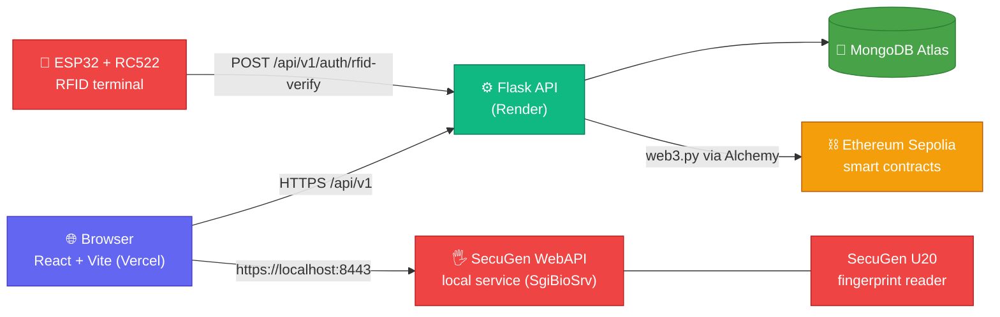

<a id="readme-top"></a>

<div align="center">


### DPDP-Compliant Blockchain-Based Personal Data Protection and Consent Management System

[](https://github.com/Bennyhinn007/DPDP-Compliant-Blockchain-Based-Personal-Data-Protection-and-Consent-Management-System)

<br/>

[](https://dpdphealthcare.bennyhinn.dev)
[](https://dpdp-backend-4zto.onrender.com/health)

[](https://github.com/Bennyhinn007/DPDP-Compliant-Blockchain-Based-Personal-Data-Protection-and-Consent-Management-System/actions/workflows/ci.yml)
[](https://github.com/Bennyhinn007/DPDP-Compliant-Blockchain-Based-Personal-Data-Protection-and-Consent-Management-System/actions/workflows/secret-scan.yml)
[](https://github.com/Bennyhinn007/DPDP-Compliant-Blockchain-Based-Personal-Data-Protection-and-Consent-Management-System/actions/workflows/keep-warm.yml)


<br/>

<a href="https://skillicons.dev"></a>

</div>

<br/>

A healthcare personal-data protection and consent management platform aligned with India's **Digital Personal Data Protection (DPDP) Act, 2023**. Patient records are encrypted at rest and anchored on a **redactable (chameleon-hash) blockchain**, so consent, access, correction and erasure rights can be honoured without breaking the audit trail. On top of this sits the **SIH 26125 identity, access and asset layer**: decentralized identifiers (DIDs), on-chain role-based access control, and ERC-721 asset NFTs.

> [!NOTE]
> Core principle: **privacy off-chain, trust on-chain.** Personal and health data stays encrypted in MongoDB. Only hashes, DIDs, roles and token references touch the blockchain. Healthcare records are never NFTs.

## 📑 Contents

- [🌐 Live demo](#-live-demo)
- [✨ Key features](#-key-features)
- [🏗️ Architecture](#️-architecture)
- [🧰 Tech stack](#-tech-stack)
- [⛓️ Smart contracts (Sepolia)](#️-smart-contracts-sepolia)
- [👥 Demo accounts](#-demo-accounts)
- [🚀 Getting started locally](#-getting-started-locally)
- [🔧 Environment variables](#-environment-variables)
- [🔌 Hardware](#-hardware)
- [☁️ Deployment](#️-deployment)
- [🛡️ Security notes and limitations](#️-security-notes-and-limitations)
- [📚 Documentation](#-documentation)
- [🗂️ Project structure](#️-project-structure)
- [📄 License and acknowledgements](#-license-and-acknowledgements)

## 🌐 Live demo

| | Link |
|---|---|
| 🖥️ Frontend | https://dpdphealthcare.bennyhinn.dev |
| 💚 Backend health | https://dpdp-backend-4zto.onrender.com/health |

> [!TIP]
> The backend runs on Render's free tier and can take up to about a minute to wake after idling. A GitHub Action pings `/health` every 10 minutes to reduce this.

## ✨ Key features

<table>
  <tr>
    <td width="50%" valign="top">
      <h3>📝 Consent and patient rights</h3>
      <ul>
        <li>Purpose-bound consent: grant, modify and revoke, with blockchain-anchored receipts.</li>
        <li>Right to access (Personal Data Center and export), correction and erasure via the redactable chameleon-hash blockchain.</li>
        <li>Immutable, hash-chained audit trail, plus a DPDP compliance score.</li>
      </ul>
    </td>
    <td width="50%" valign="top">
      <h3>🔐 Data protection</h3>
      <ul>
        <li>Fernet (AES-based) field-level encryption at rest; MongoDB stores ciphertext only.</li>
        <li>Record integrity anchored on-chain (SHA-256) with a live tamper-attempt demo.</li>
      </ul>
    </td>
  </tr>
  <tr>
    <td width="50%" valign="top">
      <h3>🧑‍⚕️ Role portals</h3>
      <ul>
        <li>Admin / DPO, doctor (healthcare provider), registration staff and patient portals.</li>
      </ul>
    </td>
    <td width="50%" valign="top">
      <h3>🔑 Authentication and presence</h3>
      <ul>
        <li>Email/password and Google sign-in.</li>
        <li>Passwordless DID login: sign an EIP-191 challenge with a key that stays in the browser.</li>
        <li>Admin MFA: Google Authenticator (TOTP), mandatory for admins (<code>ADMIN_MFA_REQUIRED</code>).</li>
        <li>Admin fingerprint second factor: SecuGen U20 via SecuGen WebAPI. Prototype: matching is client-side and the server trusts the reported score.</li>
        <li>ESP32 + RC522 RFID physical-presence verification for sensitive actions (such as record erasure), with an optional RFID second factor for DID login.</li>
      </ul>
    </td>
  </tr>
  <tr>
    <td colspan="2" valign="top">
      <h3>🪪 Identity, access and assets (SIH 26125)</h3>
      <ul>
        <li>DIDs (<code>did:rakshaid:</code>, a prototype method), on-chain RBAC (<code>PlatformAccessControl</code>), ERC-721 asset NFTs (<code>AssetNFT</code>) with a no-PHI metadata guard.</li>
        <li>Smart contracts deployed on Ethereum Sepolia. The whole layer is behind the <code>SIH_FEATURES_ENABLED</code> flag.</li>
      </ul>
    </td>
  </tr>
</table>

## 🏗️ Architecture



> [!IMPORTANT]
> If the chain is unreachable, reads degrade gracefully and critical on-chain writes fail closed (HTTP 503). The healthcare platform does not depend on chain availability.

## 🧰 Tech stack

| Layer | Technology |
|---|---|
| 🎨 Frontend | React 18, TypeScript, Vite, Tailwind CSS, TanStack Query, Recharts, Framer Motion |
| ⚙️ Backend | Python 3.13, Flask 3, PyJWT, bcrypt, pyotp, marshmallow, gunicorn, Swagger (flasgger) |
| 🍃 Database | MongoDB (Atlas in production) |
| ⛓️ Blockchain | web3.py, eth-account, Ethereum Sepolia (Ganache for local dev) |
| 📜 Contracts | Solidity 0.8.24, OpenZeppelin v5, Hardhat |
| 🔏 Crypto | Chameleon hash, Fernet encryption, SHA-256 anchoring, keccak256 (SIH), secp256k1 / EIP-191 |
| 🔌 Hardware | ESP32, RC522 RFID, SecuGen U20 |
| 🧪 Testing / CI | pytest + mongomock, Vitest, Hardhat tests, GitHub Actions, gitleaks, Dependabot |

## ⛓️ Smart contracts (Sepolia)

| Contract | Address |
|---|---|
| PlatformAccessControl | [`0xb959ae2C2e357a92fd8736eFDf69305Acf025C84`](https://sepolia.etherscan.io/address/0xb959ae2C2e357a92fd8736eFDf69305Acf025C84) |
| IdentityRegistry | [`0x80d91274844d78fC2CE9aE84Dd3871B3D415a9A1`](https://sepolia.etherscan.io/address/0x80d91274844d78fC2CE9aE84Dd3871B3D415a9A1) |
| AssetNFT | [`0x7a44a8D353cDf05fd2c93c7c822BAF11F1348651`](https://sepolia.etherscan.io/address/0x7a44a8D353cDf05fd2c93c7c822BAF11F1348651) |

Sources are in [`contracts/src`](contracts/src). Deployment steps: [`docs/sih-contracts-deploy.md`](docs/sih-contracts-deploy.md).

## 👥 Demo accounts

| Role | Email |
|---|---|
| 🩺 Doctor | `dr.rahul@citycare.in` |
| 🗂️ Registration staff | `reception@citycare.in` |
| 🧑 Patient | `rajesh.kumar@gmail.com` |
| 🧑 Patient | `priya.sharma@gmail.com` |
| 🧑 Patient | `amit.patel@gmail.com` |
| 🛡️ Admin / DPO | `admin@dpdp-health.in` (protected by MFA) |

> [!IMPORTANT]
> Demo credentials are shared privately with evaluators on request.
>
> Running locally? `python seeds/seed_demo.py` reads passwords from the `SEED_*` variables in `backend/.env`, or generates strong random ones and prints them once.

## 🚀 Getting started locally

**Prerequisites:** Python 3.13, Node.js 20+, MongoDB running locally (default `mongodb://localhost:27017`).

### ⚙️ Backend (port 5000)

```powershell
cd backend
pip install -r requirements.txt
copy .env.example .env        # macOS/Linux: cp .env.example .env
python seeds/seed_demo.py     # seed demo data (prints generated passwords once)
python run.py
```

Swagger UI is served at `http://localhost:5000/api/docs/` when `flasgger` is installed.

### 🎨 Frontend (port 5173)

```powershell
cd frontend
npm install
npm run dev
```

Open http://localhost:5173. Vite proxies `/api` to `http://localhost:5000`.

### 📜 Smart contracts (optional)

```powershell
cd contracts
npm install
npm run compile
npm test
npm run deploy:ganache    # local chain (needs a Ganache node on :8545)
npm run deploy:sepolia    # needs SEPOLIA_RPC_URL and SEPOLIA_PRIVATE_KEY in contracts/.env
```

Copy the printed addresses into `backend/.env` (`SIH_ACCESS_CONTROL_ADDRESS`, `SIH_IDENTITY_REGISTRY_ADDRESS`, `SIH_ASSET_NFT_ADDRESS`). Docker is also available via `docker-compose.yml`.

### 🧪 Tests

```powershell
cd backend;  python -m pytest -q
cd frontend; npx vitest --run
cd frontend; npx tsc --noEmit
```

CI runs `pytest -q` for the backend, and `vitest --run` plus `npm run build` (tsc + vite) for the frontend. A separate workflow scans every push and pull request for leaked secrets with gitleaks, and Dependabot checks dependencies weekly.

## 🔧 Environment variables

Names, purpose and defaults only. Never commit real values. Full list in `backend/.env.example` and `frontend/.env.example`.

<details>
<summary><b>⚙️ Backend variables</b></summary>

<br/>

| Variable | Purpose | Default |
|---|---|---|
| `FLASK_ENV` | `development`, `testing` or `production` | `development` |
| `PORT` | API port | `5000` |
| `SECRET_KEY`, `JWT_SECRET_KEY` | Flask and JWT signing secrets (required in production) | dev placeholders |
| `ENCRYPTION_KEY` | Fernet key for field encryption (required in production) | dev key in development |
| `MONGO_URI`, `MONGO_DB_NAME` | MongoDB connection | `mongodb://localhost:27017`, `dpdp_healthcare_db` |
| `CORS_ORIGINS` | Allowed frontend origins, comma-separated | `http://localhost:5173` |
| `GOOGLE_CLIENT_ID`, `GOOGLE_CLIENT_SECRET` | Google sign-in | empty |
| `BLOCKCHAIN_NETWORK` | `ganache` or `sepolia` | `ganache` |
| `GANACHE_URL`, `GANACHE_CHAIN_ID` | Local chain | `http://localhost:8545`, `1337` |
| `SEPOLIA_RPC_URL`, `SEPOLIA_PRIVATE_KEY`, `SEPOLIA_CHAIN_ID` | Sepolia access and sender account | empty, empty, `11155111` |
| `BLOCKCHAIN_EXPLORER_URL` | Explorer base for tx links | `https://sepolia.etherscan.io/tx/` |
| `SIH_FEATURES_ENABLED` | Master switch for DID / contracts / NFT layer | `true` |
| `SIH_DID_METHOD` | DID method name | `rakshaid` |
| `SIH_DID_CHALLENGE_TTL_SECONDS` | DID login challenge lifetime | `120` |
| `SIH_RFID_GATE_ENABLED` | Require RFID tap for NFT mint / DID revoke | `false` |
| `SIH_DID_LOGIN_REQUIRE_RFID` | Require RFID tap as second factor for DID login | `false` |
| `SIH_IDENTITY_REGISTRY_ADDRESS`, `SIH_ACCESS_CONTROL_ADDRESS`, `SIH_ASSET_NFT_ADDRESS` | Deployed contract addresses | empty |
| `ADMIN_MFA_REQUIRED` | Mandatory TOTP for admin login | `true` |
| `BIOMETRIC_ENABLED` | Fingerprint enroll/verify | `true` |
| `BIOMETRIC_LOGIN_ENABLED` | Fingerprint unlock at admin login | `true` |
| `BIOMETRIC_MIN_SCORE` | Minimum accepted match score | `80` |
| `PRESENCE_VALIDITY_SECONDS` | How long an RFID/fingerprint presence stays valid | `25` |
| `PROVIDER_ORG_NAME` | Provider name shown in the UI | `CityCare Hospital` |
| `KEY_STORE_PATH` | Local key store path | `./keystore` |
| `SEED_ADMIN_PASSWORD`, `SEED_DOCTOR_PASSWORD`, `SEED_STAFF_PASSWORD`, `SEED_PATIENT_PASSWORD` | Demo seed passwords (only for `seeds/seed_demo.py`) | random, printed once |

</details>

<details>
<summary><b>🎨 Frontend variables</b></summary>

<br/>

| Variable | Purpose | Default |
|---|---|---|
| `VITE_API_URL` | Backend API base URL | `/api/v1` |
| `VITE_GOOGLE_CLIENT_ID` | Google OAuth client ID (public) | empty |
| `VITE_SECUGEN_LICSTR` | SecuGen WebAPI license string (optional) | empty |

</details>

## 🔌 Hardware

### 📡 ESP32 RFID terminal

Firmware: [`hardware/esp32_rfid_terminal/esp32_rfid_terminal.ino`](hardware/esp32_rfid_terminal/esp32_rfid_terminal.ino). It reads a card with an RC522, posts the UID to `/api/v1/auth/rfid-verify`, and shows the result on LEDs: green on `GPIO25` (granted), red on `GPIO26` (denied or error). Use a 220-330 ohm resistor per LED.

| RC522 | ESP32 |
|---|---|
| SDA | GPIO 5 |
| SCK | GPIO 18 |
| MOSI | GPIO 23 |
| MISO | GPIO 19 |
| RST | GPIO 22 |
| 3.3V / GND | 3.3V / GND (never 5V) |

The terminal resolves the backend by mDNS hostname (`<host>.local`), so the PC's IP can change. Before flashing:

1. Copy `hardware/esp32_rfid_terminal/secrets.example.h` to `hardware/esp32_rfid_terminal/secrets.h`.
2. Fill in `WIFI_SSID`, `WIFI_PASSWORD` and `BACKEND_HOST` (your PC name without `.local`).
3. Flash the sketch. `secrets.h` is gitignored, so your Wi-Fi details never reach GitHub.

Enroll cards with `backend/seeds/enroll_cards.py`.

### 🖐️ SecuGen fingerprint (admin second factor)

1. Request the free SecuGen WebAPI (60-day trial) from SecuGen and install the client (`SGI_BWAPI_Win_64bit.exe`). It installs the `SgiBioSrv` service on `https://localhost:8443`.
2. A plain browser visit to `https://localhost:8443` just keeps loading. That is normal.
3. Chrome may ask to allow local network access. Allow it.
4. If SecuGen emails a license string, set `VITE_SECUGEN_LICSTR` in `frontend/.env`.
5. Sign in as admin, open Profile, then Fingerprint (SecuGen), and enroll.

> [!WARNING]
> This only works on the PC that has the reader. Do not run SecuGen's Python sample app at the same time: it also uses port 5000, which clashes with the Flask backend.

## ☁️ Deployment

| Component | Platform | Notes |
|---|---|---|
| Frontend | Vercel | Static Vite build; custom domain `dpdphealthcare.bennyhinn.dev` (`frontend/vercel.json`) |
| Backend | Render | Blueprint in `render.yaml`, gunicorn, health check `/health` |
| Database | MongoDB Atlas | Connection string set as `MONGO_URI` on Render |
| Blockchain | Ethereum Sepolia | RPC via Alchemy; secrets only in platform env vars |
| Keep-warm | GitHub Actions | `.github/workflows/keep-warm.yml` pings `/health` every 10 minutes |
| Secret scan | GitHub Actions | `.github/workflows/secret-scan.yml` runs gitleaks on every push and PR |
| Dependencies | Dependabot | `.github/dependabot.yml` opens weekly update PRs (pip, npm, Actions) |

Details: [`docs/deployment.md`](docs/deployment.md).

## 🛡️ Security notes and limitations

> [!CAUTION]
> Do not store real patient data in this prototype. Demo accounts are for evaluation only.

- Secrets (DB URI, keys, RPC URL, wallet key, Wi-Fi password) live in environment variables or gitignored files, never in the repo.
- Production refuses to start with missing or default secrets.
- Fingerprint matching is client-side; the server trusts the reported score. Treat it as prototype-grade.
- An admin whose only second factor is a fingerprint cannot log in from a PC without the reader. Keep TOTP enabled or set `BIOMETRIC_LOGIN_ENABLED=false`.
- Blockchain activity is on the Sepolia testnet only. No real-value assets.
- The `did:rakshaid:` method is a prototype, and browser key custody uses local storage.
- The chameleon-hash primitive is real; the redaction workflow is a demonstration layer.

See the [threat model](docs/threat-model.md).

## 📚 Documentation

- 🎬 [Demo script](docs/demo-script.md)
- 🧭 [Setup guide](docs/setup-guide.md)
- ☁️ [Deployment guide](docs/deployment.md)
- ⛓️ [SIH contracts deployment](docs/sih-contracts-deploy.md)
- 🛡️ [Threat model](docs/threat-model.md)
- 📊 [Chameleon-hash benchmarks](backend/benchmarks)

## 🗂️ Project structure

<details>
<summary><b>Show the repository layout</b></summary>

```
.
├── backend/              Flask API (app/, seeds/, tests/, benchmarks/, run.py)
├── frontend/             React + TypeScript + Vite UI (src/)
├── contracts/            Solidity contracts, Hardhat config, tests, deploy script
├── hardware/             ESP32 RFID terminal firmware
├── docs/                 Guides, demo script, threat model, pitch material
├── .github/
│   ├── workflows/        ci.yml, secret-scan.yml, keep-warm.yml
│   └── dependabot.yml
├── .gitleaks.toml        Secret-scan allowlist
├── docker-compose.yml
└── render.yaml           Render blueprint
```

</details>

## 📄 License and acknowledgements

License: Not specified.

Built for Smart India Hackathon problem statement 26125 (Bharat Electronics Limited). Uses OpenZeppelin Contracts, Hardhat, Flask and React.

<div align="center">

⭐ If this project helps you, consider giving it a star.

[](https://github.com/Bennyhinn007/DPDP-Compliant-Blockchain-Based-Personal-Data-Protection-and-Consent-Management-System/stargazers)
[](https://github.com/Bennyhinn007/DPDP-Compliant-Blockchain-Based-Personal-Data-Protection-and-Consent-Management-System/graphs/contributors)

[⬆ Back to top](#readme-top)


</div>
