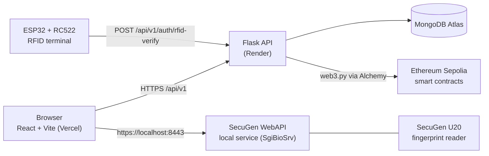

<div align="center">


# DPDP-Compliant Blockchain-Based Personal Data Protection and Consent Management System

[](https://github.com/Bennyhinn007/DPDP-Compliant-Blockchain-Based-Personal-Data-Protection-and-Consent-Management-System/actions/workflows/ci.yml)


</div>

A healthcare personal-data protection and consent management platform aligned with India's **Digital Personal Data Protection (DPDP) Act, 2023**. Patient records are encrypted at rest and anchored on a **redactable (chameleon-hash) blockchain**, so consent, access, correction and erasure rights can be honoured without breaking the audit trail. On top of this sits the **SIH 26125 identity, access and asset layer**: decentralized identifiers (DIDs), on-chain role-based access control, and ERC-721 asset NFTs.

> Core principle: **privacy off-chain, trust on-chain.** Personal and health data stays encrypted in MongoDB. Only hashes, DIDs, roles and token references touch the blockchain. Healthcare records are never NFTs.

## Contents

- [Live demo](#live-demo)
- [Key features](#key-features)
- [Architecture](#architecture)
- [Tech stack](#tech-stack)
- [Smart contracts (Sepolia)](#smart-contracts-sepolia)
- [Demo accounts](#demo-accounts)
- [Getting started locally](#getting-started-locally)
- [Environment variables](#environment-variables)
- [Hardware](#hardware)
- [Deployment](#deployment)
- [Security notes and limitations](#security-notes-and-limitations)
- [Documentation](#documentation)
- [Project structure](#project-structure)
- [License and acknowledgements](#license-and-acknowledgements)

## Live demo

| | Link |
|---|---|
| Frontend | https://dpdphealthcare.bennyhinn.dev |
| Backend health | https://dpdp-backend-4zto.onrender.com/health |

The backend runs on Render's free tier and can take up to about a minute to wake after idling. A GitHub Action pings `/health` every 10 minutes to reduce this.

## Key features

**Consent and patient rights**
- Purpose-bound consent management: grant, modify and revoke, with blockchain-anchored receipts.
- Right to access (Personal Data Center and export), correction and erasure, implemented through the redactable chameleon-hash blockchain.
- Immutable, hash-chained audit trail, plus a DPDP compliance score.

**Data protection**
- Fernet (AES-based) field-level encryption at rest; MongoDB stores ciphertext only.
- Record integrity anchored on-chain (SHA-256) with a live tamper-attempt demo.

**Role portals**
- Admin / DPO, doctor (healthcare provider), registration staff and patient portals.

**Authentication and presence**
- Email/password and Google sign-in.
- Passwordless DID login: sign an EIP-191 challenge with a key that stays in the browser.
- Admin MFA: Google Authenticator (TOTP), mandatory for admins (`ADMIN_MFA_REQUIRED`).
- Admin fingerprint second factor: SecuGen U20 through SecuGen WebAPI. Prototype: matching is client-side and the server trusts the reported score.
- ESP32 + RC522 RFID physical-presence verification for sensitive actions (such as record erasure), with an optional RFID second factor for DID login.

**Identity, access and assets (SIH 26125)**
- DIDs (`did:rakshaid:`, a prototype method), on-chain RBAC (`PlatformAccessControl`), ERC-721 asset NFTs (`AssetNFT`) with a no-PHI metadata guard.
- Smart contracts deployed on Ethereum Sepolia. The whole layer is behind the `SIH_FEATURES_ENABLED` flag.

## Architecture



If the chain is unreachable, reads degrade gracefully and critical on-chain writes fail closed (HTTP 503). The healthcare platform does not depend on chain availability.

## Tech stack

| Layer | Technology |
|---|---|
| Frontend | React 18, TypeScript, Vite, Tailwind CSS, TanStack Query, Recharts, Framer Motion |
| Backend | Python 3.13, Flask 3, PyJWT, bcrypt, pyotp, marshmallow, gunicorn, Swagger (flasgger) |
| Database | MongoDB (Atlas in production) |
| Blockchain | web3.py, eth-account, Ethereum Sepolia (Ganache for local dev) |
| Contracts | Solidity 0.8.24, OpenZeppelin v5, Hardhat |
| Crypto | Chameleon hash, Fernet encryption, SHA-256 anchoring, keccak256 (SIH), secp256k1 / EIP-191 |
| Hardware | ESP32, RC522 RFID, SecuGen U20 |
| Testing / CI | pytest + mongomock, Vitest, Hardhat tests, GitHub Actions |

## Smart contracts (Sepolia)

| Contract | Address |
|---|---|
| PlatformAccessControl | [`0xb959ae2C2e357a92fd8736eFDf69305Acf025C84`](https://sepolia.etherscan.io/address/0xb959ae2C2e357a92fd8736eFDf69305Acf025C84) |
| IdentityRegistry | [`0x80d91274844d78fC2CE9aE84Dd3871B3D415a9A1`](https://sepolia.etherscan.io/address/0x80d91274844d78fC2CE9aE84Dd3871B3D415a9A1) |
| AssetNFT | [`0x7a44a8D353cDf05fd2c93c7c822BAF11F1348651`](https://sepolia.etherscan.io/address/0x7a44a8D353cDf05fd2c93c7c822BAF11F1348651) |

Sources are in [`contracts/src`](contracts/src). Deployment steps: [`docs/sih-contracts-deploy.md`](docs/sih-contracts-deploy.md).

## Demo accounts

These are non-admin demo accounts for the public deployment.

| Role | Email | Password |
|---|---|---|
| Doctor | `dr.rahul@citycare.in` | `Doctor@123` |
| Registration staff | `reception@citycare.in` | `Staff@123` |
| Patient | `rajesh.kumar@gmail.com` | `Patient@123` |
| Patient | `priya.sharma@gmail.com` | `Patient@456` |
| Patient | `amit.patel@gmail.com` | `Patient@789` |
| Admin / DPO | Credentials are available on request (admin is protected by MFA) | |

## Getting started locally

**Prerequisites:** Python 3.13, Node.js 20+, MongoDB running locally (default `mongodb://localhost:27017`).

### Backend (port 5000)

```powershell
cd backend
pip install -r requirements.txt
copy .env.example .env        # macOS/Linux: cp .env.example .env
python seeds/seed_demo.py     # seed demo data
python run.py
```

Swagger UI is served at `http://localhost:5000/api/docs/` when `flasgger` is installed.

### Frontend (port 5173)

```powershell
cd frontend
npm install
npm run dev
```

Open http://localhost:5173. Vite proxies `/api` to `http://localhost:5000`.

### Smart contracts (optional)

```powershell
cd contracts
npm install
npm run compile
npm test
npm run deploy:ganache    # local chain (needs a Ganache node on :8545)
npm run deploy:sepolia    # needs SEPOLIA_RPC_URL and SEPOLIA_PRIVATE_KEY in contracts/.env
```

Copy the printed addresses into `backend/.env` (`SIH_ACCESS_CONTROL_ADDRESS`, `SIH_IDENTITY_REGISTRY_ADDRESS`, `SIH_ASSET_NFT_ADDRESS`). Docker is also available via `docker-compose.yml`.

### Tests

```powershell
cd backend;  python -m pytest -q
cd frontend; npx vitest --run
cd frontend; npx tsc --noEmit
```

CI runs `pytest -q` for the backend and `npm run build` (tsc + vite) for the frontend.

## Environment variables

Names, purpose and defaults only. Never commit real values. Full list in `backend/.env.example` and `frontend/.env.example`.

### Backend

| Variable | Purpose | Default |
|---|---|---|
| `FLASK_ENV` | `development`, `testing` or `production` | `development` |
| `PORT` | API port | `5000` |
| `SECRET_KEY`, `JWT_SECRET_KEY` | Flask and JWT signing secrets (required in production) | dev placeholders |
| `ENCRYPTION_KEY` | Fernet key for field encryption (required in production) | dev key in development |
| `MONGO_URI`, `MONGO_DB_NAME` | MongoDB connection | `mongodb://localhost:27017`, `dpdp_healthcare_db` |
| `CORS_ORIGINS` | Allowed frontend origins, comma-separated | `http://localhost:5173` |
| `GOOGLE_CLIENT_ID`, `GOOGLE_CLIENT_SECRET` | Google sign-in | empty |
| `BLOCKCHAIN_NETWORK` | `ganache` or `sepolia` | `ganache` |
| `GANACHE_URL`, `GANACHE_CHAIN_ID` | Local chain | `http://localhost:8545`, `1337` |
| `SEPOLIA_RPC_URL`, `SEPOLIA_PRIVATE_KEY`, `SEPOLIA_CHAIN_ID` | Sepolia access and sender account | empty, empty, `11155111` |
| `BLOCKCHAIN_EXPLORER_URL` | Explorer base for tx links | `https://sepolia.etherscan.io/tx/` |
| `SIH_FEATURES_ENABLED` | Master switch for DID / contracts / NFT layer | `true` |
| `SIH_DID_METHOD` | DID method name | `rakshaid` |
| `SIH_DID_CHALLENGE_TTL_SECONDS` | DID login challenge lifetime | `120` |
| `SIH_RFID_GATE_ENABLED` | Require RFID tap for NFT mint / DID revoke | `false` |
| `SIH_DID_LOGIN_REQUIRE_RFID` | Require RFID tap as second factor for DID login | `false` |
| `SIH_IDENTITY_REGISTRY_ADDRESS`, `SIH_ACCESS_CONTROL_ADDRESS`, `SIH_ASSET_NFT_ADDRESS` | Deployed contract addresses | empty |
| `ADMIN_MFA_REQUIRED` | Mandatory TOTP for admin login | `true` |
| `BIOMETRIC_ENABLED` | Fingerprint enroll/verify | `true` |
| `BIOMETRIC_LOGIN_ENABLED` | Fingerprint unlock at admin login | `true` |
| `BIOMETRIC_MIN_SCORE` | Minimum accepted match score | `80` |
| `PRESENCE_VALIDITY_SECONDS` | How long an RFID/fingerprint presence stays valid | `25` |
| `PROVIDER_ORG_NAME` | Provider name shown in the UI | `CityCare Hospital` |
| `KEY_STORE_PATH` | Local key store path | `./keystore` |

### Frontend

| Variable | Purpose | Default |
|---|---|---|
| `VITE_API_URL` | Backend API base URL | `/api/v1` |
| `VITE_GOOGLE_CLIENT_ID` | Google OAuth client ID (public) | empty |
| `VITE_SECUGEN_LICSTR` | SecuGen WebAPI license string (optional) | empty |

## Hardware

### ESP32 RFID terminal

Firmware: [`hardware/esp32_rfid_terminal/esp32_rfid_terminal.ino`](hardware/esp32_rfid_terminal/esp32_rfid_terminal.ino). It reads a card with an RC522, posts the UID to `/api/v1/auth/rfid-verify`, and shows the result on LEDs: green on `GPIO25` (granted), red on `GPIO26` (denied or error). Use a 220-330 ohm resistor per LED.

| RC522 | ESP32 |
|---|---|
| SDA | GPIO 5 |
| SCK | GPIO 18 |
| MOSI | GPIO 23 |
| MISO | GPIO 19 |
| RST | GPIO 22 |
| 3.3V / GND | 3.3V / GND (never 5V) |

The terminal resolves the backend by mDNS hostname (`<host>.local`), so the PC's IP can change. Set your own Wi-Fi and host values in the sketch before flashing, and do not commit them. Enroll cards with `backend/seeds/enroll_cards.py`.

### SecuGen fingerprint (admin second factor)

1. Request the free SecuGen WebAPI (60-day trial) from SecuGen and install the client (`SGI_BWAPI_Win_64bit.exe`). It installs the `SgiBioSrv` service on `https://localhost:8443`.
2. A plain browser visit to `https://localhost:8443` just keeps loading. That is normal.
3. Chrome may ask to allow local network access. Allow it.
4. If SecuGen emails a license string, set `VITE_SECUGEN_LICSTR` in `frontend/.env`.
5. Sign in as admin, open Profile, then Fingerprint (SecuGen), and enroll.

This only works on the PC that has the reader. Do not run SecuGen's Python sample app at the same time: it also uses port 5000, which clashes with the Flask backend.

Mantra MFS100: the adapter is not implemented yet.

## Deployment

| Component | Platform | Notes |
|---|---|---|
| Frontend | Vercel | Static Vite build; custom domain `dpdphealthcare.bennyhinn.dev` (`frontend/vercel.json`) |
| Backend | Render | Blueprint in `render.yaml`, gunicorn, health check `/health` |
| Database | MongoDB Atlas | Connection string set as `MONGO_URI` on Render |
| Blockchain | Ethereum Sepolia | RPC via Alchemy; secrets only in platform env vars |
| Keep-warm | GitHub Actions | `.github/workflows/keep-warm.yml` pings `/health` every 10 minutes |

Details: [`docs/deployment.md`](docs/deployment.md).

## Security notes and limitations

- Secrets (DB URI, keys, RPC URL, wallet key) live in environment variables, never in the repo.
- Production refuses to start with missing or default secrets.
- Fingerprint matching is client-side; the server trusts the reported score. Treat it as prototype-grade.
- An admin whose only second factor is a fingerprint cannot log in from a PC without the reader. Keep TOTP enabled or set `BIOMETRIC_LOGIN_ENABLED=false`.
- Blockchain activity is on the Sepolia testnet only. No real-value assets.
- The `did:rakshaid:` method is a prototype, and browser key custody uses local storage.
- The chameleon-hash primitive is real; the redaction workflow is a demonstration layer.
- The accounts above are public demo credentials. Do not store real patient data.

See the [threat model](docs/threat-model.md).

## Documentation

- [Demo script](docs/demo-script.md)
- [Setup guide](docs/setup-guide.md)
- [Deployment guide](docs/deployment.md)
- [SIH contracts deployment](docs/sih-contracts-deploy.md)
- [Threat model](docs/threat-model.md)
- [Chameleon-hash benchmarks](backend/benchmarks)

## Project structure

```
.
├── backend/              Flask API (app/, seeds/, tests/, benchmarks/, run.py)
├── frontend/             React + TypeScript + Vite UI (src/)
├── contracts/            Solidity contracts, Hardhat config, tests, deploy script
├── hardware/             ESP32 RFID terminal firmware
├── docs/                 Guides, demo script, threat model, pitch material
├── .github/workflows/    ci.yml, keep-warm.yml
├── docker-compose.yml
└── render.yaml           Render blueprint
```

## License and acknowledgements

License: Not specified.

Built for Smart India Hackathon problem statement 26125 (Bharat Electronics Limited). Uses OpenZeppelin Contracts, Hardhat, Flask and React.
